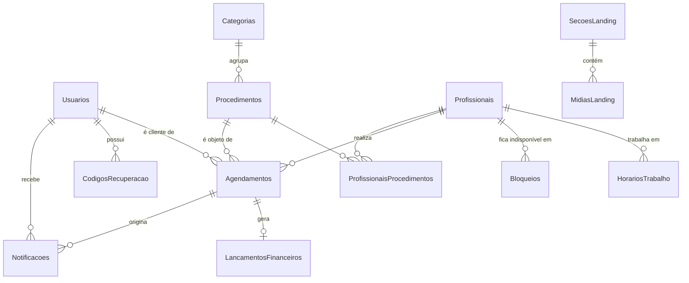

# Modelagem do banco de dados

Documento de apoio à parte escrita do TCC. Descreve as entidades do sistema
Florescer, seus atributos e, principalmente, **por que** cada relacionamento
foi modelado daquela forma.

O banco é gerado pelo Entity Framework Core no modelo *Code First*: as classes
C# em `Florescer.Domain/Entidades` são a fonte da verdade, e as migrations
traduzem essas classes em tabelas do SQL Server.

---

## 1. Visão geral

O modelo tem 16 tabelas, organizadas em cinco blocos:

| Bloco | Tabelas |
|---|---|
| **Acesso** | Usuarios, CodigosRecuperacao |
| **Catálogo** | Categorias, Procedimentos |
| **Equipe e agenda** | Profissionais, ProfissionaisProcedimentos, HorariosTrabalho, Bloqueios |
| **Operação** | Agendamentos, LancamentosFinanceiros, Notificacoes |
| **Divulgação** | SecoesLanding, MidiasLanding, Depoimentos, Faqs, ConfiguracaoEstabelecimento |

### Diagrama de relacionamentos

---

## 2. Bloco de acesso

### Usuarios

Pessoa que acessa o sistema.

| Coluna | Tipo | Observação |
|---|---|---|
| Id | int | Chave primária, identidade |
| Nome | varchar(120) | Obrigatório |
| Email | varchar(160) | **Índice único** — identifica o login |
| Telefone | varchar(20) | Usado na recuperação por SMS/WhatsApp |
| SenhaHash | varchar(300) | Formato `salt.hash`, ambos em Base64 |
| Perfil | int | 1 = Cliente, 2 = Administrador |
| Ativo | bit | Permite desativar sem excluir |
| CriadoEm | datetime2 | |

**Decisão de modelagem — tabela única para clientes e administradores.**
Uma alternativa comum seria criar tabelas separadas `Clientes` e
`Administradores`. Optou-se por uma tabela única com o campo `Perfil` porque:

1. Os dois perfis compartilham exatamente os mesmos atributos (nome, e-mail,
   senha, telefone);
2. A autenticação fica centralizada em um único lugar;
3. Evita duplicar a lógica de hash de senha e de recuperação de conta.

Essa técnica é conhecida como *herança por tabela única* (single-table
inheritance). O custo é que, se no futuro os perfis passarem a ter atributos
muito diferentes, será necessário separar as tabelas.

**Por que o e-mail tem índice único.** É ele que identifica o usuário no login.
O índice cumpre duas funções: garante que dois cadastros não usem o mesmo
e-mail e acelera a consulta feita em toda tentativa de login.

### CodigosRecuperacao

Código numérico de uso único enviado a quem esqueceu a senha.

| Coluna | Tipo | Observação |
|---|---|---|
| Id | int | Chave primária |
| UsuarioId | int | Chave estrangeira → Usuarios |
| Codigo | varchar(6) | Seis dígitos |
| Canal | int | E-mail, SMS ou WhatsApp |
| ExpiraEm | datetime2 | Validade de 15 minutos |
| UsadoEm | datetime2 nulo | Preenchido no uso, impede reutilização |
| Tentativas | int | Bloqueia após 5 erros |
| CriadoEm | datetime2 | |

**Relacionamento:** `Usuarios (1) → (N) CodigosRecuperacao`, com exclusão em
cascata. Um usuário pode ter vários códigos ao longo do tempo, mas apenas o
mais recente e não usado é válido — os anteriores são invalidados quando um
novo é gerado.

**Decisão — código em vez de link com token.** Um link de redefinição só
funciona bem por e-mail. O código de seis dígitos funciona identicamente nos
três canais, o que permitiu escrever a regra de recuperação uma única vez.

---

## 3. Bloco de catálogo

### Categorias

| Coluna | Tipo | Observação |
|---|---|---|
| Id | int | Chave primária |
| Nome | varchar(60) | Unhas, Cabelo, Spa, Estética |
| Slug | varchar(30) | **Índice único** — identificador usado pelo front |
| Cor | varchar(9) | Hexadecimal usado nos gráficos |
| Ordem | int | Define a sequência de exibição |
| Ativa | bit | |

### Procedimentos

| Coluna | Tipo | Observação |
|---|---|---|
| Id | int | Chave primária |
| CategoriaId | int | Chave estrangeira → Categorias |
| Nome | varchar(120) | |
| Descricao | varchar(400) | Opcional |
| DuracaoMinutos | int | Base do cálculo de disponibilidade |
| Preco | decimal(10,2) | Preço de tabela atual |
| Ativo | bit | |

**Relacionamento:** `Categorias (1) → (N) Procedimentos`, com
`DeleteBehavior.Restrict`. A restrição impede apagar uma categoria que ainda
tenha procedimentos, o que deixaria registros órfãos.

**Decisão — `decimal(10,2)` e não `float` para o preço.** Tipos de ponto
flutuante têm erro de arredondamento: `0.1 + 0.2` não resulta exatamente em
`0.3`. Em valores monetários esses centavos se acumulam e distorcem relatórios.
O tipo `decimal` armazena o número em base 10 e é exato.

**Decisão — exclusão lógica.** Procedimentos não são apagados, apenas marcados
como inativos. Excluir de verdade quebraria os agendamentos e lançamentos
financeiros antigos que apontam para eles.

---

## 4. Bloco de equipe e agenda

### Profissionais

| Coluna | Tipo | Observação |
|---|---|---|
| Id | int | Chave primária |
| Nome | varchar(120) | |
| Especialidade | varchar(60) | Manicure, Cabeleireira, Esteticista... |
| Email, Telefone, FotoUrl | | Opcionais |
| Ativa | bit | |
| CriadoEm | datetime2 | |

### ProfissionaisProcedimentos (tabela associativa)

| Coluna | Tipo | Observação |
|---|---|---|
| ProfissionalId | int | Parte da chave primária composta |
| ProcedimentoId | int | Parte da chave primária composta |

**Relacionamento N:N.** Uma profissional executa vários procedimentos e um
procedimento pode ser executado por várias profissionais. Bancos relacionais
não representam N:N diretamente, então é preciso uma terceira tabela.

A **chave primária composta** `(ProfissionalId, ProcedimentoId)` garante que o
mesmo par não seja cadastrado duas vezes — a integridade fica assegurada pelo
próprio banco, sem depender de verificação no código.

É esta tabela que implementa a regra "cada profissional realiza apenas os
procedimentos cadastrados para ela": na etapa de escolha da profissional, o
sistema consulta aqui quem está habilitada para o procedimento selecionado.

### HorariosTrabalho

Jornada semanal. Cada linha representa um dia da semana trabalhado.

| Coluna | Tipo | Observação |
|---|---|---|
| Id | int | Chave primária |
| ProfissionalId | int | Chave estrangeira → Profissionais |
| DiaSemana | int | 0 = domingo ... 6 = sábado |
| HoraInicio | time | |
| HoraFim | time | |

**Decisão — ausência de linha significa folga.** Em vez de uma coluna booleana
"trabalha neste dia", um dia sem linha já representa que a profissional não
atende. O modelo fica menor e permite, no futuro, cadastrar jornadas diferentes
por dia (por exemplo, sábado até as 14h) sem alterar a estrutura.

Há um índice em `(ProfissionalId, DiaSemana)`, porque essa é a consulta feita
toda vez que a disponibilidade é calculada.

### Bloqueios

Períodos de indisponibilidade que se sobrepõem à jornada normal.

| Coluna | Tipo | Observação |
|---|---|---|
| Id | int | Chave primária |
| ProfissionalId | int **nulo** | Quando nulo, vale para todo o estabelecimento |
| Inicio, Fim | datetime2 | |
| Tipo | int | Folga, Férias, Feriado, Bloqueio pontual |
| Motivo | varchar(200) | |

**Decisão — chave estrangeira opcional.** Permitir `ProfissionalId` nulo evita
criar uma segunda tabela só para feriados do estabelecimento. Um feriado é um
bloqueio sem profissional associada.

---

## 5. Bloco de operação

### Agendamentos

Entidade central do sistema.

| Coluna | Tipo | Observação |
|---|---|---|
| Id | int | Chave primária |
| ClienteId | int | Chave estrangeira → Usuarios |
| ProfissionalId | int | Chave estrangeira → Profissionais |
| ProcedimentoId | int | Chave estrangeira → Procedimentos |
| Inicio | datetime2 | |
| Fim | datetime2 | Calculado a partir da duração |
| Status | int | Agendado, Confirmado, Concluído, Cancelado |
| ValorPrevisto | decimal(10,2) | Cópia do preço no momento da reserva |
| PrazoConfirmacao | datetime2 | Calculado pela regra 24h/2h |
| ConfirmadoEm, ConcluidoEm, CanceladoEm | datetime2 nulo | |
| MotivoCancelamento | int nulo | Cliente, admin, falta de confirmação, não compareceu |
| Observacoes | varchar(300) | |
| CriadoEm | datetime2 | |

**Três chaves estrangeiras com `DeleteBehavior.Restrict`.** Nenhuma cliente,
profissional ou procedimento pode ser apagado enquanto houver agendamento
apontando para ele. Por isso o sistema usa exclusão lógica em toda parte.

**Decisão — guardar `Fim` em vez de recalcular.** O fim poderia ser deduzido de
`Inicio + DuracaoMinutos`, mas armazená-lo transforma a detecção de conflito em
uma comparação simples entre dois intervalos, que o banco resolve com índice.
Além disso, se a duração do procedimento mudar depois, os agendamentos
anteriores mantêm o horário que foi realmente combinado com a cliente.

**Decisão — `ValorPrevisto` duplica o preço do procedimento.** À primeira vista
parece redundância, mas é intencional: o preço na tabela `Procedimentos` é o
preço *atual*, enquanto `ValorPrevisto` é o preço *acordado*. Sem essa cópia,
um reajuste de preços reescreveria retroativamente todo o histórico financeiro.
Esse padrão é chamado de *snapshot* de valor.

**Decisão — `MotivoCancelamento` separado do `Status`.** Poderia haver um
status "CanceladoPorFaltaDeConfirmacao", mas isso multiplicaria os estados
possíveis. Separar *o que aconteceu* (status) de *por que aconteceu* (motivo)
mantém a máquina de estados simples e permite medir quanto da agenda se perde
por esquecimento — informação que alimenta o indicador de perda do painel
financeiro.

**Índices:** `(ProfissionalId, Inicio)` atende à consulta mais frequente do
sistema ("o que esta profissional tem marcado neste período?"); há também
índices em `Inicio` e `Status`, usados pelo calendário e pelos relatórios.

### LancamentosFinanceiros

| Coluna | Tipo | Observação |
|---|---|---|
| Id | int | Chave primária |
| Tipo | int | 1 = Receita, 2 = Despesa |
| AgendamentoId | int **nulo** | Chave estrangeira → Agendamentos |
| Valor | decimal(10,2) | Valor efetivamente apurado |
| Data | datetime2 | Data de competência (dia do atendimento) |
| Descricao | varchar(200) | |
| RegistradoPorUsuarioId | int nulo | Quem deu a baixa — rastreabilidade |
| CriadoEm | datetime2 | |

**Relacionamento 1:1 opcional com Agendamentos.** Um agendamento gera no máximo
um lançamento, e só depois que o administrador dá a baixa. A exclusão é em
cascata: apagar um agendamento apaga seu lançamento.

**Decisão — `Tipo` já previsto, despesas ainda não implementadas.** Nesta
versão o sistema apura apenas o ganho com os serviços prestados. O campo `Tipo`
foi incluído desde o início para que o controle de despesas possa ser
habilitado no futuro apenas com uma tela nova, sem migração de banco.

**Decisão — data de competência e não data de caixa.** A receita é registrada
com a data do atendimento, e não a do pagamento. Isso é o que a contabilidade
chama de *regime de competência*: o resultado do mês reflete os serviços
prestados naquele mês. Como o sistema não processa pagamentos, essa é também a
única data confiável disponível.

### Notificacoes

| Coluna | Tipo | Observação |
|---|---|---|
| Id | int | Chave primária |
| UsuarioId | int | Destinatário |
| AgendamentoId | int nulo | Agendamento relacionado, quando houver |
| Canal | int | E-mail, SMS, WhatsApp |
| Tipo | int | Criado, lembrete, confirmado, cancelado... |
| Destino | varchar(160) | E-mail ou telefone |
| Assunto, Mensagem | | Texto gerado |
| Status | int | Pendente, Enviada, Falhou, Simulada |
| Erro | varchar(400) | |
| EnviadaEm, CriadaEm | datetime2 | |

**Índice em `(AgendamentoId, Tipo)`.** É consultado pela rotina automática para
não enviar o mesmo lembrete duas vezes para o mesmo agendamento.

**Decisão — gravar toda notificação, inclusive as simuladas.** Como SMS e
WhatsApp funcionam em modo simulado, a tabela é o que permite auditar o que foi
comunicado e demonstrar o fluxo completo na apresentação.

---

## 6. Bloco de divulgação

Tabelas que sustentam a landing page e são editadas pela aba Vitrine.

### SecoesLanding

| Coluna | Tipo | Observação |
|---|---|---|
| Id | int | Chave primária |
| Chave | varchar(40) | **Índice único** — `hero`, `servicos`, `faq`... |
| Titulo, Subtitulo, Texto, TextoBotao, ImagemUrl | | Conteúdo editável |
| Ordem | int | |
| Ativa | bit | Liga/desliga a seção na página |

**Decisão — `Chave` fixa em vez de posição livre.** O front usa a chave para
saber onde renderizar cada bloco. Isso permite que o administrador altere
textos e imagens sem risco de quebrar o layout, o que aconteceria em um editor
totalmente livre.

### MidiasLanding

| Coluna | Tipo | Observação |
|---|---|---|
| Id | int | Chave primária |
| SecaoLandingId | int nulo | Chave estrangeira, `DeleteBehavior.SetNull` |
| Url | varchar(300) | Caminho do arquivo em `wwwroot/uploads` |
| Legenda, Ordem, Ativa | | |

**Decisão — arquivo em disco, caminho no banco.** Guardar a imagem como binário
na tabela deixaria o banco pesado e as consultas lentas. Gravar o arquivo em
`wwwroot/uploads` e apenas o caminho no banco é a prática usual e mantém o
backup do banco leve.

O nome do arquivo é gerado pelo servidor (`Guid`), nunca reaproveitado do envio.
Usar o nome original permitiria que um upload sobrescrevesse outro, ou que um
caminho malicioso escapasse da pasta de destino.

### Depoimentos, Faqs e ConfiguracaoEstabelecimento

`Depoimentos` e `Faqs` são tabelas simples, com `Ordem` e um campo de
ativação. `ConfiguracaoEstabelecimento` é uma tabela de **registro único**:
guarda nome, endereço, telefone, WhatsApp e redes sociais do estabelecimento.

---

## 7. Resumo das cardinalidades

| Relacionamento | Cardinalidade | Comportamento na exclusão |
|---|---|---|
| Categoria → Procedimento | 1:N | Restrict |
| Profissional ↔ Procedimento | N:N (tabela associativa) | Cascade |
| Profissional → HorarioTrabalho | 1:N | Cascade |
| Profissional → Bloqueio | 1:N | Cascade |
| Usuario → Agendamento | 1:N | Restrict |
| Profissional → Agendamento | 1:N | Restrict |
| Procedimento → Agendamento | 1:N | Restrict |
| Agendamento → LancamentoFinanceiro | 1:1 opcional | Cascade |
| Usuario → CodigoRecuperacao | 1:N | Cascade |
| Usuario → Notificacao | 1:N | Cascade |
| Agendamento → Notificacao | 1:N | Cascade |
| SecaoLanding → MidiaLanding | 1:N | SetNull |

**Critério adotado:** `Cascade` quando o registro filho não faz sentido sozinho
(um horário de trabalho sem profissional, um código de recuperação sem
usuário). `Restrict` quando apagar destruiria histórico — e é justamente por
isso que o sistema usa exclusão lógica em usuários, profissionais e
procedimentos.
